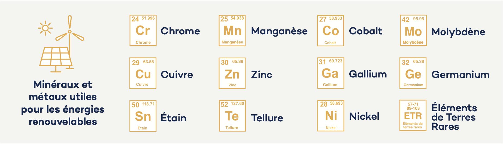

```{r}
#| include: false
library(knitr)
library(readr)
library(gt)

opts_chunk$set(
  echo = FALSE,
  warning = FALSE,
  message = FALSE
)
```

# La transition énergétique déplace la rareté

Produire de l'électricité sans émettre de CO₂ se heurte à trois obstacles majeurs : l'intermittence des énergies renouvelables, l'acceptabilité sociale des politiques climatiques, et la dépendance aux matières premières critiques (MPC). Ce troisième défi, longtemps sous-estimé, retient désormais l'attention des économistes et des décideurs publics.

Le fait de prendre en compte les MPC dans la transition énergétique introduit une contrainte supplémentaire d'épuisement, venant s'ajouter à celle du budget carbone. D'une certaine manière, la question de la rareté s'est déplacée au fil du temps dans la littérature en économie de l'environnement. Cette problématique est apparue pour la première fois dans les années 1970 avec les combustibles fossiles épuisables, qui limitaient la croissance. Elle a ensuite été suivie, dans les années 2000 et 2010, par la question du changement climatique, modélisée sous la forme d'un budget carbone --- donc d'une épuisabilité de ce budget --- qui impose une contrainte plus forte à l'économie que l'épuisement des combustibles fossiles, dans la mesure où brûler l'ensemble des combustibles fossiles disponibles rendrait impossible le respect du budget carbone [voir @McGladeEkins2015]. La contrainte liée aux combustibles fossiles est ainsi devenue, dans une certaine mesure, obsolète, et celle portant sur les émissions de carbone pourrait ne pas empêcher la croissance grâce au développement des énergies renouvelables. Cependant, depuis le début des années 2020, nous sommes désormais confrontés à un nouveau problème de ressources épuisables, lié aux MPC, qui limite le développement des infrastructures liées aux énergies renouvelables et, par conséquent, la croissance. Finalement, avec les renouvelables, la transition énergétique déplace simplement la rareté liée à l'existence d'un budget carbone vers la rareté minérale.

La liste des MPC a été actualisée dans le Critical Raw Materials (CRM) Act[^1] de l'UE en 2024 et dans cette liste, les matières premières stratégiques[^2], c'est-à-dire celles qui sont essentielles aux technologies stratégiques utilisées dans les domaines des applications vertes, numériques, de la défense et de l'aérospatiale ont été précisées. Il s'agit notamment des intrants irremplaçables pour les batteries de véhicules électriques, les éoliennes, les panneaux solaires, les aimants permanents des moteurs et les semi-conducteurs (voir @fig-mineraux-enr).

[^1]: Voir la liste mise à jour dans le CRM Act de l'UE [ici](https://eur-lex.europa.eu/legal-content/EN/TXT/?uri=OJ:L_202401252), Annexe II.

[^2]: Voir [ici](https://eur-lex.europa.eu/legal-content/EN/TXT/?uri=OJ:L_202401252), Annexe I.

La demande européenne en terres rares devrait être multipliée par six entre 2023 et 2030 et par sept entre 2023 et 2050. Celle en lithium devrait être multipliée par douze à l'horizon 2030 et par vingt et un en 2050[^3]. Il est aussi prévu que la demande mondiale augmente beaucoup (voir @fig-croissance-sds). Ces ordres de grandeur illustrent l'ampleur d'un choc de demande sans précédent.


[^3]: Voir l'[étude prospective](https://publications.jrc.ec.europa.eu/repository/handle/JRC142643) du @JRC142643 associée au CRM Act.

::: {#fig-mineraux-enr}


*Source :* @IGF2022.

Minéraux et métaux utiles pour les énergies renouvelables
:::

Au-delà de la demande tirée par la transition énergétique, il existe aussi une préoccupation de sécurité nationale concernant le rôle prospectif des MPC pour les industries du numérique et de la défense.

::: {#fig-croissance-sds}
```{r}
#| fig-width: 5.5
#| fig-height: 3
#| out-width: "60%"
library(ggplot2)

croissance <- read.csv("data/fig2_croissance_minerais.csv")

ggplot(croissance, aes(indice_2040, reorder(minerai, indice_2040),
                       fill = minerai == "Lithium")) +
  geom_col(width = 0.65) +
  geom_text(aes(label = paste0("×", etiquette_source)), hjust = -0.2, size = 3.5,
            fontface = "bold", colour = "grey20") +
  scale_fill_manual(values = c(`TRUE` = "#B5401C", `FALSE` = "#E9B97A"), guide = "none") +
  scale_x_continuous(limits = c(0, 47), expand = c(0, 0)) +
  labs(x = "Demande en 2040, indice 2020 = 1", y = NULL) +
  theme_minimal(base_size = 10) +
  theme(panel.grid = element_blank(), axis.text.x = element_blank(),
        axis.text.y = element_text(size = 10, colour = "grey15"),
        plot.margin = margin(6, 10, 6, 6))
```

*Source :* @AIE2022.

Croissance de certains minerais dans le scénario SDS[^4], en 2040 par rapport à 2020
:::

[^4]: Sustainable Development Scenario

Malgré le rôle central des MPC dans la transition énergétique, les travaux scientifiques existants se sont principalement concentrés sur les contraintes physiques. La littérature dominante s'appuie sur l'analyse des flux de matières, principalement développée par des géologues projetant la demande en MPC induite par le déploiement à grande échelle des technologies bas carbone [par ex. @VidalGoffeArndt2013]. Bien que ces contributions soient essentielles, elles font abstraction des mécanismes économiques --- prix, pouvoir de marché, innovation, comportements stratégiques --- qui sont pourtant susceptibles de façonner de manière déterminante les résultats effectifs. La littérature économique théorique a quant à elle longtemps ignoré les MPC. Les modèles standard traitent l'énergie renouvelable comme une technologie de substitution disponible à coût constant, sans tenir compte du fait que le déploiement du capital vert requiert des intrants minéraux épuisables.

# Politique climatique sous contrainte de rareté des minerais

## Le cadre de base : deux contraintes simultanées

@PommeretRicciSchubert2022 introduisent dans l'analyse économique de la transition énergétique la contrainte sur les MPC en supplément de la contrainte de budget carbone. Comme dans @PommeretSchubert2022, l'économie produit de l'électricité à partir de deux sources parfaitement substituables --- l'énergie fossile et le capital vert[^5] --- mais le déploiement du capital vert (panneaux solaires, éoliennes, batteries) requiert des minéraux épuisables -- les MPC -- comme intrants. À ces derniers peut se substituer une technologie de backstop, disponible en quantité illimitée mais à un coût unitaire très élevé. Il existe donc un arbitrage entre une technologie émettrice et une technologie qui épuise les MPC.

[^5]: Ce capital vert combine génération d'électricité et « back-up » pour gérer l'intermittence de sorte que l'électricité fournie soit de même « nature ».

Le planificateur social maximise le surplus net actualisé de la société sous deux contraintes de ressources non renouvelables : d'une part, un budget carbone --- le stock cumulé d'émissions ne peut dépasser un seuil climatique fixé --- et d'autre part, un stock initial de MPC. La résolution analytique permet de caractériser une trajectoire de transition par phases successives, dont la séquence dépend de la taille relative des deux stocks. Les deux ressources --- budget carbone et MPC --- sont épuisées en temps fini et le modèle est paramétré de façon à ce que ce soit le budget carbone qui soit épuisé avant le stock de MPC. En cohérence avec la règle de Hotelling appliquée aux MPC, la rente de rareté des minéraux croît au taux d'actualisation jusqu'à atteindre le coût du backstop. La trajectoire de consommation d'électricité suit un profil en V : décroissante dans la phase fossile, puis croissante au fur et à mesure de l'accumulation du capital vert.

## Une politique climatique contrainte

Comparée à une situation où les MPC seraient abondantes, la rareté minérale modifie les caractéristiques de la transition énergétique. Une réduction de 10 % du stock de minéraux génère une perte de bien-être équivalente à une baisse permanente de 2 % de la consommation d'électricité. En comparaison, une réduction de 20 % du budget carbone entraîne une perte équivalente à 10,9 %. Les deux ressources ont des effets qualitatifs différents : des minéraux plus abondants bénéficient surtout aux consommations futures (phase backstop), tandis qu'un budget carbone plus généreux bénéficie davantage aux phases précoces de la transition.

Dans l'économie décentralisée, la seule défaillance de marché est le changement climatique. La politique optimale consiste à taxer le carbone à hauteur de sa valeur sociale, sans subvention aux énergies renouvelables. Les recettes fiscales sont redistribuées sous forme de transferts forfaitaires. Cependant, une politique climatique plus réaliste --- taxe carbone constante dont les recettes financent un tarif de rachat pour l'électricité renouvelable, comme le font beaucoup d'États membres --- est significativement sous-optimale. Elle génère une perte de bien-être équivalente à une baisse permanente de 8,4 % de la consommation d'électricité. Pire : elle peut imposer un taux de taxe carbone initial plus élevé que la politique optimale, ce qui contredit l'objectif d'acceptabilité sociale qui la motive.

**Ignorer que les minéraux sont épuisables revient à sous-estimer leur coût réel, et donc le coût de la transition énergétique. Le régulateur dimensionne insuffisamment la politique environnementale (taxe carbone trop faible), l'utilisation des combustibles fossiles reste plus élevée, et les émissions cumulées de CO₂ dépassent la limite fixée. Planifier la transition énergétique sans tenir compte des contraintes minérales conduit à dépasser le budget carbone et repousser la date de sortie du fossile.**

Les travaux de @PommeretRicciSchubert2022 ont été les premiers à formaliser cette contrainte dans un modèle d'équilibre général dynamique : ils montrent que la rareté des MPC constitue une contrainte additionnelle sur la transition, et que l'ignorer conduit à des erreurs systématiques et coûteuses de politique climatique. Des travaux ultérieurs ont commencé à étendre ce cadre. @FischerKurzvanderMeijden2025 intègrent les interactions stratégiques entre régions disposant d'un pouvoir de marché. Lorsque l'Est (la Chine) exerce un pouvoir de marché, il ralentit sa propre extraction de minerais, obligeant l'Ouest à épuiser ses réserves minérales plus rapidement. Cela augmente les coûts de production des biens d'équipement verts dans l'Ouest, retarde la transition énergétique et réduit le bien-être dans la région. Le recyclage des minerais dans l'Ouest peut réduire la dépendance. @ChenPaulusRuanZou2025 analysent les marchés des MPC à l'aide d'un jeu dynamique entre pays exportateurs et importateurs, en mettant l'accent sur le recyclage et la substitution. Ces travaux prennent à la fois l'innovation et les ressources comme données (en revanche les réserves[^6] sont bien déterminées en fonction du prix). Les études empiriques, en revanche, se concentrent principalement sur les chaînes de valeur en aval et l'innovation [par ex. @AlfaroFadingerSchymikVirananda2025; @BastianinRomaniRossiniZoso2025; @NoaillyYilmaz2025].

[^6]: On rappelle que les réserves sont un concept économique : ce sont les ressources qu'il est rentable d'exploiter, compte tenu de la technologie d'extraction disponible et du prix de la matière.

## Le rôle central du recyclage

Le recyclage des MPC incorporées dans le capital vert déprécié constitue une source d'approvisionnement secondaire qui modifie en profondeur la dynamique optimale de la transition. La règle optimale est simple : le taux de recyclage doit être ajusté de façon à égaliser le coût marginal de recyclage avec la rente de rareté des minéraux primaires. En d'autres termes, on recycle d'autant plus que les minéraux sont chers.

En présence de recyclage, les résultats analytiques de @PommeretRicciSchubert2022 montrent une série de changements dans la trajectoire optimale de transition. Il y a davantage de capital vert à l'état stationnaire, la consommation d'électricité est toujours plus élevée, et les ressources fossiles sont utilisées plus tôt --- ce qui constitue un paradoxe vert faible : une légère augmentation des émissions à court terme, sans conséquence néfaste pour le climat[^7] car le budget carbone reste respecté. La sortie des fossiles est anticipée, tandis que le recours au backstop et l'épuisement des minéraux primaires sont repoussés. Un résultat particulièrement original est la sur-accumulation temporaire de capital vert juste avant le passage au backstop. Il est en effet optimal d'accumuler intensivement du capital vert à ce moment, afin de disposer d'un stock suffisant de matériaux recyclables à partir de cette date. **Le recyclage améliore le bien-être collectif, réduit la pression sur les minéraux primaires, et modifie le calendrier optimal de la transition énergétique.**

[^7]: Les « tipping points » sont supposés inexistants tant que le budget carbone est respecté.

L'approche de @BenchekrounDaiRicci2025 enrichit cette analyse en introduisant le pouvoir de marché des pays exportateurs de MPC et les externalités positives de production dans le secteur du recyclage. La question est de savoir comment des gouvernements importateurs devraient subventionner le recyclage pour réduire leur dépendance à des fournisseurs dominants. Ces travaux montrent qu'en présence de pouvoir de marché en amont, la subvention optimale au recyclage est plus élevée que dans un marché concurrentiel : il faut non seulement corriger les externalités positives du recyclage (économies d'agglomération, effets d'apprentissage), mais aussi contrebalancer le pouvoir de marché du fournisseur dominant. Ce résultat plaide pour une politique européenne de soutien au recyclage qui soit calibrée sur le degré de concentration du marché des MPC concernées, et non pour une subvention uniforme.

## Reconvertir les infrastructures fossiles : des actifs échoués aux matériaux de la transition

Les politiques climatiques rendent progressivement les centrales à combustibles fossiles non rentables avant la fin de leur durée de vie économique, créant des actifs échoués (« stranded assets ») qui pèsent sur les bilans des entreprises énergétiques et freinent l'acceptabilité sociale des politiques de décarbonation. Les gouvernements et entreprises propriétaires de ces actifs ont des incitations puissantes à en retarder l'échouage, ce qui constitue l'un des obstacles majeurs à une transition rapide.

@PommeretRicci2026 identifient un mécanisme négligé : les infrastructures fossiles démantelées constituent un stock de ferraille dont les matériaux --- acier, cuivre, aluminium --- peuvent être récupérés et recyclés pour construire précisément les nouvelles infrastructures renouvelables. Le démantèlement des actifs fossiles, loin d'être un simple coût, devient ainsi une source potentielle de matériaux secondaires qui soulage la contrainte minérale de la transition.

Le modèle est une extension du cadre de @PommeretRicciSchubert2022 qui intègre une innovation méthodologique majeure : le taux de démantèlement des infrastructures fossiles devient une variable de contrôle. La quantité de ferraille recyclable générée dépend donc non seulement de la dépréciation physique des infrastructures mais aussi d'une décision d'optimisation. L'économie produit de l'électricité à partir de capital brun (centrales fossiles) et de capital vert (renouvelables). L'investissement en capital vert peut être financé par trois sources : les minéraux vierges, le recyclage de la ferraille issue du démantèlement des centrales fossiles, ou une technologie de backstop coûteuse. En raison de la structure linéaire des coûts de recyclage, ces sources ne peuvent jamais être utilisées simultanément. La résolution du modèle identifie quatre phases successives dans la trajectoire optimale de transition. Dans la première phase, les minéraux vierges sont utilisés et le décommissionnement est actif mais le recyclage inactif --- la ferraille s'accumule mais les minéraux primaires restent moins coûteux. Dans la deuxième phase, le recyclage démarre lorsque son coût total égale la rente des minéraux vierges, tandis que ces derniers s'épuisent. Dans la troisième phase, le recyclage continue à partir du stock de ferraille accumulé, sans génération nouvelle par le démantèlement dont le capital brun est entièrement retraité. Enfin, la ferraille s'épuise et l'économie recourt exclusivement au backstop.

Le résultat central et le plus contre-intuitif de cet article est que la valeur de la ferraille est positive et croissante tout au long de la transition. Cela signifie que les infrastructures fossiles démantelées conservent de la valeur --- non plus comme outil de production d'électricité, mais comme réservoir de matériaux utiles à la construction d'infrastructure verte. En d'autres termes, les actifs fossiles ne sont pas vraiment échoués : leur valeur comme ferraille compense progressivement la perte de leur valeur productive. En atténuant le risque d'actifs échoués, le recyclage des matériaux issus des infrastructures fossiles réduit l'opposition des investisseurs aux politiques de décarbonation. C'est un argument économique en faveur de politiques coordonnant démantèlement et recyclage des infrastructures fossiles. Les simulations numériques, calibrées sur données de l'Union européenne montrent aussi que le recyclage réduit la tension sur le prix des matières premières, le prix initial des minéraux vierges étant 89 % plus élevé en l'absence de recyclage, ce qui reflète la disparition de toute alternative bon marché aux minéraux primaires.

Cependant, le problème de MPC s'est récemment déplacé vers l'offre et vers le court terme, le tournant ayant eu lieu avec la pandémie de Covid-19, la guerre en Ukraine et les restrictions chinoises à l'exportation.

# Une forte dépendance aux importations

L'Europe ne produit qu'une fraction marginale des MPC qu'elle consomme. Sa dépendance aux importations est à la fois massive et concentrée sur un petit nombre de pays tiers, dont plusieurs présentent un profil géopolitique préoccupant. La Chine fournit 99 % des terres rares lourdes, 47 % du graphite naturel, 93 % du magnésium, et 49 % du bismuth consommés dans l'UE. La RDC couvre 68 % des importations européennes de cobalt, le Chili 78 % du lithium, la Guinée 64 % de la bauxite. Pour l'aluminium, la Chine reste le premier fournisseur mondial de produits raffinés (voir aussi @fig-fournisseurs-ue).

<!-- RELECTURE : Les parts citées ici (99 % terres rares lourdes, 47 % graphite, 93 % magnésium, etc.) proviennent-elles de la même source et de la même année que la carte (Commission 2020) ? Une étude de la Commission de 2023 existe ; le rapport spécial 04/2026 de la Cour des comptes européenne donne par ex. 97 % pour le magnésium. À vérifier et harmoniser. -->

Cette concentration crée une vulnérabilité structurelle. Contrairement au pétrole, dont les chocs affectent l'ensemble de l'économie, les chocs sur les MPC n'impactent que certains secteurs et produits spécifiques --- mais des secteurs stratégiques pour la compétitivité et la défense européennes. De plus, les marchés des MPC sont caractérisés par de longs délais de mise en production, des investissements initiaux importants et de faibles élasticités d'offre à court terme : la réponse de l'offre mondiale à un choc de demande ou à une rupture géopolitique peut prendre des années.

Les travaux empiriques le confirment : les marchés de minéraux sont particulièrement vulnérables à la fragmentation géoéconomique. @AlvarezEtAl2026 montrent, à partir d'un modèle d'équilibre partiel, que les économies européennes feraient face à des augmentations prononcées des prix des minerais raffinés en cas de fragmentation commerciale --- notamment le magnésium, le platine, le palladium et l'aluminium. Avec moins de partenaires commerciaux, les hausses de prix lors d'un choc d'offre équivalent sont mécaniquement plus violentes, et le changement de camp géopolitique d'un seul exportateur majeur peut provoquer une pénurie sévère.

::: {#fig-fournisseurs-ue}
```{r}
#| fig-width: 9
#| fig-height: 5.2
library(sf)
library(ggplot2)
library(dplyr)
library(ggtext)

pct <- function(x) paste0(x, " %")
fournisseurs <- read.csv("data/fig3_fournisseurs_ue.csv") |>
  group_by(iso3, pays) |>
  summarise(part_max = max(part),
            texte = paste0(matiere, " ", pct(part), collapse = "<br>"),
            .groups = "drop")
monde <- st_read("data/fig3_fond_carte.gpkg", quiet = TRUE) |>
  left_join(fournisseurs, by = c("ISO3_CODE" = "iso3"))

eqe <- "+proj=eqearth"
# Position des étiquettes (lon, lat) et alignement horizontal
etiquettes <- tribble(
  ~iso3, ~lon, ~lat, ~hj,
  "NOR",   -2,  70,    1,   "FIN",  33,  66, 0,   "FRA",  -7,  56, 1,
  "DEU",   15,  53,    0,   "ESP", -12,  40, 1,   "MAR", -13,  31.5, 1,
  "TUR",   32,  33,  0.5,   "KAZ",  70,  58, 0,   "CHN", 130,  48, 0,
  "MEX", -106,  27,    1,   "GIN", -16,  14, 1,   "COD",  31,  -1, 0,
  "IDN",  124,  10,    0,   "BRA", -37, -10, 0,   "CHL", -74, -22, 1,
  "AUS",  134, -40,  0.5) |>
  left_join(fournisseurs, by = "iso3") |>
  mutate(label = paste0("<b>", pays, "</b><br>", texte)) |>
  st_as_sf(coords = c("lon", "lat"), crs = 4326) |>
  st_transform(eqe)
etiquettes <- bind_cols(st_drop_geometry(etiquettes),
                        as.data.frame(st_coordinates(etiquettes)))

ggplot() +
  geom_sf(data = monde, aes(fill = part_max), colour = "white", linewidth = 0.15) +
  geom_richtext(data = etiquettes, aes(X, Y, label = label, hjust = hj),
                vjust = 1, size = 2.4, lineheight = 1.05,
                fill = alpha("white", 0.75), label.colour = NA,
                label.r = unit(1.5, "pt"),
                label.padding = unit(c(1.5, 2.5, 1.5, 2.5), "pt")) +
  scale_fill_steps(low = "#FBE3B9", high = "#B5401C", na.value = "grey85",
                   breaks = c(40, 60, 80), limits = c(20, 100), labels = pct,
                   name = "Part de l'approvisionnement de l'UE\n(matière la plus dépendante du pays)",
                   guide = guide_coloursteps(barwidth = unit(6, "cm"),
                                             barheight = unit(0.25, "cm"),
                                             title.position = "top")) +
  coord_sf(crs = eqe, expand = FALSE) +
  theme_void(base_size = 9) +
  theme(legend.position = "bottom", plot.margin = margin(4, 4, 4, 4))
```

*Source :* European Commission, Study on the EU's list of CRM (2020).

Fournisseurs principaux de l'UE en MPC
:::

## La réponse politique européenne : du leadership industriel à l'autonomie stratégique

La prise de conscience européenne s'est construite progressivement. L'Initiative sur les matières premières lancée en 2008 visait à maintenir le leadership industriel dans la transition énergétique. La première liste officielle de MPC, publiée en 2011, répondait à une logique de compétitivité économique. Le vrai tournant a eu lieu avec la séquence de chocs des années 2020 : la pandémie de Covid-19 a révélé la fragilité des chaînes d'approvisionnement mondiales, la guerre en Ukraine a souligné le risque d'arme commerciale, et les restrictions chinoises à l'exportation de gallium et germanium en 2023 ont matérialisé la menace.


L'objectif s'est alors radicalement recentré sur la notion *d'autonomie stratégique*. Comme le formule le rapport Draghi [-@Draghi2024], dans les secteurs stratégiques, « les entreprises européennes doivent conserver les savoir-faire et capacités de production pour pouvoir réagir rapidement en cas de tensions géopolitiques. »

En réponse, l'UE a adopté le Critical Raw Materials Act (CRM Act) en 2024, qui fixe quatre objectifs collectifs à horizon 2030 :

- au moins 10 % de la consommation annuelle doit provenir d'une extraction domestique,
- au moins 40 % d'un raffinage local,
- au moins 25 % du recyclage interne,
- et aucun pays tiers ne doit représenter plus de 65 % des importations d'une matière stratégique.

En mars 2025, la Commission européenne a sélectionné 47 projets prioritaires couvrant l'extraction, le raffinage et le recyclage, répartis dans toute l'Europe --- dont deux sites d'extraction de lithium en France (Allier et Alsace) et des mines de cobalt en Espagne, de cuivre en Roumanie, de gallium en Grèce, de graphite en Suède et de lithium en Finlande. La @fig-projets-mines présente les projets de mines en cours en Europe.

::: {#fig-projets-mines}
```{r}
#| fig-width: 8
#| fig-height: 6
#| out-width: "80%"
library(sf)
library(ggplot2)

fond <- st_read("data/fig4_fond_carte.gpkg", quiet = TRUE)
projets <- read.csv("data/fig4_projets_mines.csv") |>
  st_as_sf(coords = c("lon", "lat"), crs = 4326)

ggplot() +
  geom_sf(data = fond, fill = "grey96", colour = "grey75", linewidth = 0.2) +
  geom_sf(data = projets, colour = "red", size = 0.9) +
  coord_sf(crs = st_crs(3857), default_crs = st_crs(4326),
           xlim = c(-78, 52), ylim = c(29.5, 78), expand = FALSE) +
  scale_x_continuous(breaks = seq(-75, 45, by = 15)) +
  scale_y_continuous(breaks = seq(30, 70, by = 10)) +
  theme_minimal(base_size = 9) +
  theme(panel.background = element_rect(fill = "#D3D8DA", colour = NA),
        panel.grid = element_line(colour = "grey60", linewidth = 0.2),
        panel.ontop = FALSE,
        axis.title = element_blank())
```

*Source :* @BastianinDelBoShamsudin2025, based on data from Owen, J.R., Lèbre, É. and Kemp, D. (2022).

Projets de mines en cours en Europe (définition large)
:::

## Valoriser la souveraineté : le coût du CRM Act

La notion de souveraineté[^souverainete] est omniprésente dans les discours politiques sur les MPC, mais n'est jamais quantifiée économiquement. Comment évaluer le coût que l'Europe accepte de payer pour son autonomie stratégique ? @LeclercqOllivierPommeret2026 répondent à cette question en traitant la souveraineté comme le coût d'une contrainte de production domestique.

L'approche repose sur un raisonnement coût-efficacité : si l'UE s'impose une contrainte de production domestique alors que celle-ci est plus coûteuse que l'importation, c'est qu'elle estime implicitement que la souveraineté obtenue vaut au moins ce surcoût. Le coût de la contrainte devient ainsi une mesure plancher de la valeur de la souveraineté. C'est une approche descendante (top-down), analogue au prix tutélaire du carbone : plutôt que d'évaluer directement la valeur de l'autonomie stratégique (difficile à mesurer), on part de l'objectif politique et on en déduit le coût marginal.

Le modèle est calibré sur le manganèse (minerai de l'aluminium) dans l'UE. Les simulations montrent que le coût courant de la contrainte --- la différence entre le coût de la solution avec raffinage domestique et celui du tout-importé --- augmente de façon convexe jusqu'en 2030, date d'entrée en vigueur de la contrainte de raffinage (40 %), où il atteint un pic de l'ordre de 30 millions d'euros avant de se stabiliser autour de 160 à 13 millions d'euros par an. Le niveau de consommation de manganèse en Europe à l'équilibre contraint est inférieur d'environ 3 % à celui qui prévaudrait sans contrainte.

<!-- RELECTURE : (a) « manganèse (minerai de l'aluminium) » : le minerai de l'aluminium est la bauxite ; le manganèse sert surtout à l'acier et aux batteries. Quelle matière est effectivement calibrée ? (la note sur Chvaletice indique le manganèse). (b) Coût de la contrainte : un pic « de l'ordre de 30 millions » suivi d'une stabilisation « autour de 160 à 13 millions d'euros par an » n'est pas cohérent (niveau stabilisé supérieur au pic, fourchette inversée). Valeurs à vérifier dans LeclercqOllivierPommeret2026. L'ancienne conclusion mentionnait 400 M€/an « pour l'aluminium » : à réconcilier. -->

Ce chiffre est à interpréter soigneusement : il ne mesure pas ce que la souveraineté « vaut » aux décideurs européens, mais ce qu'ils acceptent de payer pour l'obtenir. C'est une mesure plancher --- si la souveraineté ne valait pas au moins ce montant, la politique serait sans fondement. Ce cadre analytique est applicable à l'ensemble des matières premières couvertes par le CRM Act[^8] et constitue un outil précieux pour évaluer la cohérence des politiques publiques.

<!-- RELECTURE : Les chiffres de cette section (30 M€, etc.) et ceux des sections sur le recyclage des actifs fossiles (89 %) et sur les permis (32 trimestres, VAN proche de zéro) proviennent de documents de travail non publiés : préciser qu'il s'agit d'ordres de grandeur issus de simulations calibrées ? -->

[^souverainete]: Historiquement associé aux relations entre États [@philpottSovereigntyIntroductionBrief1995], le terme de souveraineté a été récemment utilisé comme synonyme d’« autonomie » ou d’« indépendance », en lien avec des domaines plus spécifiques tels que l’alimentation, l’énergie ou les ressources minérales. 

[^8]: Le manganèse a été choisi en raison de la disponibilité des données, grâce au [projet Chvaletice](https://www.mn25.ca/chvaletice-manganese-project) en République Tchèque.

::: {.callout-note title="La réponse française : entre raffinage et mise à jour de l'inventaire des ressources"}

La réponse française : entre raffinage et mise à jour de l'inventaire des ressources

La France a lancé en février 2025 une actualisation de son inventaire des ressources minérales, l'objectif étant de mieux connaître le potentiel du sous-sol national. Cet inventaire couvre désormais une soixantaine d'éléments, contre une vingtaine auparavant, dont certains --- comme le lithium, le gallium ou le germanium --- étaient absents ou mal détectés lors des premières campagnes.

Le programme, piloté par le BRGM sur une période de cinq ans, se concentre prioritairement sur cinq régions à fort potentiel géologique : l'ouest du Massif central, la zone Morvan-Brévenne, les Vosges, l'Occitanie-Cévennes et le sillon nord de la Guyane. En métropole, les secteurs sélectionnés regroupent soit des ressources déjà identifiées mais encore insuffisamment délimitées --- notamment quant à leurs extensions potentielles --- soit des zones présentant un potentiel reconnu pour la découverte de métaux critiques et stratégiques. En Guyane, la partie septentrionale du territoire se distingue par une grande diversité de minéralisations, comprenant notamment l'or, le cuivre, le plomb, le zinc, le lithium, le niobium et le tantale.

Par ailleurs, une note de la Direction Générale du Trésor fait état d'un projet de *« club de confiance »* entre pays qui veulent sécuriser leurs approvisionnements en métaux critiques, l'objectif n'étant pas tant de sécuriser l'approvisionnement en matières premières que d'augmenter leur capacité de les raffiner et de les transformer.
:::


# Ouvrir des mines : une décision sous incertitude géopolitique

L'ouverture d'une mine de MPC est assimilable à une décision irréversible dans l'incertain qui peut être étudiée avec la théorie des options réelles (voir @tbl-analogie-options). Détenir une réserve minérale non développée, c'est posséder le droit (l'option) --- mais pas l'obligation --- d'investir dans son développement. Comme pour une option d'achat, la décision d'exercer ce droit (ouvrir la mine) est irréversible : une fois la mine ouverte, la possibilité d'attendre de meilleures conditions est perdue définitivement.

## Options réelles et choc géopolitique

Ce parallèle a des implications profondes pour la décision d'investissement. La règle classique de la valeur actuelle nette (VAN) recommande d'investir dès que la VAN est positive. Mais cette règle ignore la valeur de l'option de report : même si le projet est rentable aujourd'hui, il peut être préférable d'attendre, parce que demain les conditions pourraient être encore meilleures --- ou parce qu'on obtiendra davantage d'informations. La théorie des options réelles introduit un seuil de déclenchement plus élevé : il faut que la valeur attendue du projet dépasse non seulement les coûts, mais aussi la valeur de l'option d'attente. En général, plus l'incertitude est grande, plus ce seuil est élevé --- et donc plus l'investissement est retardé. C'est la conclusion habituelle de la littérature sur les options réelles appliquées à l'industrie minière. @FodhaPommeretRicci2026 montrent que cette conclusion n'est pas universelle dans le cas des MPC soumises à un risque géopolitique.

```{r}
#| label: tbl-analogie-options
#| tbl-cap: "Analogie avec les options financières et les réserves pétrolières"
read_csv("data/table/analogie_options_reelles.csv", show_col_types = FALSE) |>
  gt() |>
  cols_label(
    element = "Élément",
    option_achat = "Option d'achat (call)",
    reserve_petroliere = "Réserve pétrolière",
    mine_non_developpee = "Mine non développée"
  ) |>
  tab_style(
    style = cell_text(weight = "bold"),
    locations = cells_body(columns = element)
  )
```

Le modèle représente la décision d'un gouvernement --- et non d'une entreprise privée --- cherchant à maximiser l'intérêt général. Cette perspective est essentielle : elle introduit une prime de souveraineté, c'est-à-dire une valeur supplémentaire liée à l'indépendance stratégique qui s'ajoute à la rentabilité purement financière du projet. La valeur brute que le gouvernement attribue à une mine en activité dépend du prix mondial de la MPC et du niveau du PIB national --- ce second facteur captant l'idée que plus l'économie est active, plus la valeur d'une production nationale sécurisée est grande.

L'innovation principale du modèle consiste à représenter la dynamique des prix par deux types de processus stochastiques superposés. Les fluctuations continues du marché sont modélisées par des mouvements browniens géométriques --- un outil standard en finance pour représenter des grandeurs qui tendent à croître sur le long terme tout en étant soumises à des chocs aléatoires dans les deux sens. À cela s'ajoute un processus de Poisson représentant les sauts soudains à la hausse des prix de MPC, qui peuvent se produire lorsqu'un choc géopolitique --- embargo, rupture d'une chaîne d'approvisionnement, décision d'un pays exportateur --- se matérialise. Ce saut est caractérisé par sa probabilité d'occurrence et par son amplitude. L'asymétrie de ce choc est cruciale : les sauts géopolitiques ne jouent qu'à la hausse des prix, jamais à la baisse. À partir de ce cadre, les auteurs calculent analytiquement le seuil optimal de déclenchement de l'investissement, c'est-à-dire la valeur brute de la mine à partir de laquelle il est rationnel de l'ouvrir, compte tenu de l'ensemble des incertitudes. Ce seuil est la solution d'un système d'équations intégrant à la fois la valeur de l'option d'attente et la valeur anticipée de la mine en activité.

Deux effets jouent en sens contraire. D'un côté, une plus grande incertitude continue augmente la valeur de l'option d'attente --- c'est l'effet standard qui conduit à retarder l'investissement. Mais d'un autre côté, les chocs géopolitiques se traduisent exclusivement par des hausses de prix (asymétrie fondamentale de la fragmentation géoéconomique), ce qui accroît mécaniquement la valeur anticipée de la mine en activité. Cet effet positif sur la valeur du projet peut être suffisamment fort pour dominer l'effet d'attente, aboutissant au résultat inverse : plus le risque géopolitique est élevé, plus il devient rationnel d'ouvrir la mine tôt. Ce résultat donne un fondement analytique rigoureux à un élément du rapport Draghi [-@Draghi2024], qui avance que la « valeur d'option » de ces investissements « croît exponentiellement dans les scénarios extrêmes, comme l'a montré la coupure du gaz russe. »

En ce qui concerne les fluctuations continues des prix et du PIB, les résultats sont plus proches de la littérature standard sur les options réelles : une plus grande volatilité tend à élever le seuil de déclenchement de l'investissement, c'est-à-dire à repousser l'ouverture de la mine. Cependant, les effets sont là aussi ambigus lorsque les chocs sur les prix des MPC et sur le PIB sont positivement corrélés, ce qui est le cas pour l'Europe. Tous ces résultats nuancent l'approche naïve qui consiste à utiliser la volatilité des prix comme justification pour retarder l'investissement minier. L'analyse identifie également un mécanisme additionnel : une incertitude accrue peut générer des réalisations plus élevées de la valeur de la mine, rendant plus probable l'atteinte du seuil de déclenchement. Cela implique une date d'ouverture espérée plus précoce pour un seuil donné.

## Trois mécanismes par lesquels le recyclage affecte les décisions minières

L'article de @FodhaPommeretRicci2026 identifie trois canaux distincts par lesquels le développement du recyclage affecte la décision d'ouvrir de nouvelles mines de MPC. Ces canaux ont des effets qui jouent en sens opposés, ce qui explique pourquoi l'effet total du recyclage sur les décisions minières est théoriquement indéterminé.

Le premier est un effet d'échelle : si les matériaux extraits d'une mine peuvent être recyclés ultérieurement, la valeur sociale de cette mine augmente, chaque tonne extraite pouvant donc être utilisée plusieurs fois au fil du temps. Cet effet augmente directement la valeur anticipée de la mine et tend à avancer la date optimale d'investissement.

Le second est un effet d'assurance : un secteur de recyclage développé réduit la dépendance de l'économie nationale aux importations de MPC et donc sa sensibilité aux chocs de prix mondiaux. Dans le modèle, cela se traduit par une réduction de l'élasticité de la valeur de la mine par rapport au PIB. L'effet net sur le seuil d'investissement est ambigu : le recyclage réduit d'un côté le risque lié à l'ouverture de la mine, mais ralentit aussi la croissance attendue de sa valeur.

Le troisième est un effet d'isolation : en absorbant une partie de la demande européenne de MPC, le recyclage réduit la corrélation entre les chocs de demande intérieure et les prix mondiaux des MPC. Là encore, l'effet net est ambigu : cela réduit l'exposition au risque, mais aussi le potentiel de hausse de la valeur du projet.

Ces résultats nuancent la position de l'Agence Internationale de l'Énergie, qui présente le recyclage comme un levier permettant de réduire l'extraction, estimant qu'un développement ambitieux du recyclage peut réduire le besoin en nouvelles mines de 25 à 40 % d'ici 2050. Les travaux présentés ici montrent qu'en théorie, l'effet net dépend de paramètres empiriques difficiles à estimer, notamment l'élasticité-prix de la demande de MPC et qu'on ne peut exclure qu'extraction et recyclage soient plutôt complémentaires.


# Conséquences macroéconomiques des MPC et politique publique

Peu d'attention a été portée jusqu'à présent aux effets des MPC sur les mécanismes de propagation macroéconomiques. Les chocs affectant la disponibilité ou les prix des MPC affectent l'extraction, la composition de la production, les pressions inflationnistes, les décisions d'investissement, les budgets publics et les équilibres extérieurs. Cela nécessite la construction d'un cadre macroéconomique dynamique et cohérent, tel qu'un modèle DSGE (« Dynamic Stochastic General Equilibrium ») appliqué aux futurs besoins en MPC, avec des agents rationnels, des coûts d'ajustement, des instruments de politique économique et de l'incertitude. Cette intégration macroéconomique des MPC est nécessaire pour dépasser les débats sectoriels et éclairer les choix publics.

L'objectif est d'étudier la manière dont les autorités publiques évaluent et gouvernent les stratégies relatives aux MPC, et de formuler des recommandations de politiques publiques, lorsque les connaissances sur le sous-sol national, les trajectoires de demande, la concentration des marchés, la substitution technologique, les contraintes environnementales et les chocs géopolitiques interagissent au fil du temps.

## Externalités et chocs sur le prix mondial des MPC

@AurayDiPacePommeret2026 proposent un modèle d'équilibre général stochastique dynamique (DSGE) calibré sur données françaises. Ce modèle intègre quatre blocs d'agents --- ménages, secteur hors-mine, secteur minier, et secteur de raffinage/transformation. La contribution originale de ce travail est d'analyser la propagation des chocs sur le prix mondial des MPC et de caractériser la distorsion d'extraction qui justifie une intervention publique dans le secteur des MPC : les externalités environnementales négatives (pollution, perte de biodiversité) et la valeur de rareté du stock souterrain domestique ne sont pas intégralement intégrées par les acteurs privés.

Le secteur non-minier utilise capital, travail et MPC pour produire le bien final. La spécification de la fonction de production[^9] permet de rendre compte que les MPC sont *nécessaires* à la production car même si les quantités requises sont faibles, elles peuvent constituer un goulot d'étranglement pour l'économie. Dans le secteur minier, l'extraction engendre un coût privé croissant et convexe par rapport au stock de ressource restant[^10]. Enfin, la dynamique du secteur minier s'articule autour de deux stocks qui évoluent conjointement de façon à reproduire l'ajustement lent de l'extraction suite à un choc. La masse de mines actives s'accroît des projets ayant passé avec succès le processus d'autorisation, tandis que la masse de projets en cours d'autorisation s'alimente de nouvelles entrées et se réduit à mesure que ces projets deviennent actifs. Le processus d'autorisation tient compte des délais administratifs (« legal licence to operate ») mais aussi de ceux engendrés par la faible acceptabilité des mines (« social licence to operate ») ; on peut s'attendre à ce que ces délais soient d'autant plus élevés que le régime est démocratique. Le modèle est calibré sur l'économie française.

[^9]: De forme Stone-Geary, de sorte que la productivité marginale tend vers l'infini lorsque la quantité utilisée de MPC se rapproche d'un minimum défini à 0,9 fois la consommation finale.

[^10]: Cette convexité garantit que les mines dégagent des rentes d'exploitation positives, égales à une fraction du coût privé total supporté.

### Taxe pigouvienne et redevance de rareté

Le modèle DSGE de @AurayDiPacePommeret2026 propose une politique publique qui corrige la distorsion d'extraction. Une taxe égale à la somme du dommage environnemental marginal et de la valeur de rareté du stock national, doit être prélevée sur chaque tonne extraite. La « redevance de rareté » internalise la valeur du stock souterrain national --- une valeur ignorée par les opérateurs privés qui ne tiennent pas compte de la valeur d'option du stock pour les générations futures.

Suite à un choc sur le prix des MPC (augmentation), la quantité utilisée de MPC se réduit à un niveau proche du niveau minimal, tandis que le travail s'ajuste largement. Le nombre de mines actives augmente progressivement, à cause des délais d'autorisation. Cependant, la taxe déplace l'effort de la marge intensive (chaque mine produit plus) vers la marge extensive (plus de mines).

## Quelles autres politiques publiques pour les MPC ?

D'autres instruments de politique publique pourraient corriger les distorsions du marché des MPC. Ces instruments sont complémentaires et doivent être coordonnés pour être efficaces.

### Réglementation macroprudentielle sectorielle

Les frictions d'emprunt propres au secteur minier (leviers élevés, spreads importants, délais de gestation longs) créent un accélérateur financier sectoriel qui amplifie les cycles d'investissement. L'investissement minier et l'extraction réagissent lentement aux chocs de prix positifs --- contraintes d'emprunt et dynamique d'accumulation --- mais s'effondrent brutalement à la suite de chocs négatifs. La troisième est une distorsion de sécurité : l'absence de réserve stratégique expose l'économie aux ruptures d'approvisionnement géopolitiques.


Un plafond de levier contracyclique imposé aux intermédiaires financiers opérant dans le secteur minier permettrait d'atténuer l'accélérateur financier sectoriel : resserrement du plafond lors des périodes d'expansion (pour éviter la surchauffe), assouplissement lors des récessions (pour soutenir l'investissement).

### Prix plancher et réserve stratégique

Le prix plancher garanti sur les MPC transformées couplé à une réserve stratégique publique --- est sans doute la plus originale sur le plan de la politique économique. Un prix plancher remplit un double rôle. D'une part, il soutient une réserve stratégique positive en permettant à l'État d'acheter des MPC lorsque les prix mondiaux sont bas et de libérer les stocks lors des épisodes de tension. D'autre part, il relève le prix anticipé à la sortie de mine et réduit le risque à la baisse pour les investisseurs, ancrant les anticipations des entreprises minières et accélérant l'ouverture de nouvelles mines.


L'analyse de @LeclercqOllivierPommeret2026 préconise spécifiquement ce mécanisme pour réduire le coût de la contrainte de souveraineté du CRM Act. Par ailleurs, en constituant des stocks stratégiques et en garantissant un prix plancher, l'État réduit l'incertitude sur les revenus futurs qui affecte largement l'investissement minier en Europe, comme montré dans @FodhaPommeretRicci2026.

### L'accélération des permis : un levier sous-estimé

Le modèle DSGE de @AurayDiPacePommeret2026 identifie les délais d'autorisation comme l'un des obstacles les plus importants à l'investissement minier en Europe. Avec un délai attendu de 32 trimestres (8 ans) pour obtenir un permis d'exploitation, la valeur actuelle nette d'un projet médian est proche de zéro dans le régime de référence. Réduire ces délais de 8--10 ans à 4--5 ans constitue l'un des leviers les plus puissants pour élever la rentabilité sociale des projets miniers médians, sans nécessiter de subvention directe.

<!-- RELECTURE : Chiffres (32 trimestres, VAN proche de zéro) issus d'un document de travail non publié : préciser qu'il s'agit d'ordres de grandeur de simulation ? -->

Ce résultat est cohérent avec la priorité accordée par la Commission européenne à la simplification des procédures d'autorisation dans le cadre du CRM Act. Les 47 projets prioritaires sélectionnés en mars 2025 bénéficient précisément d'un statut d'intérêt public permettant d'accélérer les procédures administratives. Mais les travaux académiques suggèrent que cette accélération doit s'accompagner du maintien de standards environnementaux stricts, au risque sinon d'accentuer la distorsion d'extraction et de sous-internaliser les coûts environnementaux.

# Conclusion : sécuriser les MPC, une question de stratégie

L'Union européenne aborde la question des matières premières critiques en position de faiblesse. Sa dépendance aux énergies fossiles importées, révélée brutalement par la crise gazière de 2022, l'oblige à accélérer le déploiement des technologies bas carbone. Or ces technologies reposent sur des matières dont l'extraction, et plus encore le raffinage, sont concentrés dans un petit nombre de pays, au premier rang desquels la Chine. Sans stratégie crédible, l'Europe risque de remplacer une dépendance par une autre. Le CRM Act adopté en 2024 traduit une prise de conscience réelle, mais ses objectifs pour 2030 paraissent aujourd'hui difficilement atteignables[^cce].

La sécurité d'approvisionnement en MPC n'est donc pas un accessoire de politique industrielle : elle conditionne la réussite de la politique climatique. Ignorer la contrainte minérale conduit à sous-estimer le coût de la transition et à mal calibrer les instruments climatiques.

Les travaux économiques récents éclairent trois arbitrages au cœur de cette stratégie.

**Ouvrir des mines maintenant ou attendre.** L'incertitude incite habituellement à reporter un investissement irréversible. Mais lorsque le risque principal est un choc géopolitique qui ne peut que faire monter les prix, il peut au contraire justifier d'investir plus tôt. Pour les matières les plus exposées et encore peu recyclées, développer une production et un raffinage domestiques relève de l'assurance plus que du pari.

**Extraire ou recycler.** Le recyclage améliore le bien-être collectif et réduit la pression sur les ressources primaires, mais il ne peut pas remplacer l'extraction tant que le stock de matériaux en circulation reste faible. À court et moyen terme, les deux sont complémentaires. Le soutien public au recyclage devrait être d'autant plus fort que le marché de la matière concernée est concentré.

**Produire chez soi ou diversifier.** La souveraineté a un coût, mesurable comme le surcoût accepté de la production domestique par rapport aux importations. Le rendre explicite permet de le comparer à celui d'une diversification par des partenariats avec des pays tiers fiables, et de choisir matière par matière plutôt que de fixer des cibles uniformes.

Plusieurs leviers permettent de réduire ce coût : raccourcir les délais d'autorisation sans abaisser les standards environnementaux ; garantir un prix plancher adossé à une réserve stratégique pour sécuriser les revenus des investisseurs ; faire supporter à l'extraction son coût environnemental et la valeur de rareté du sous-sol ; et coordonner ces outils au niveau européen, y compris dans les partenariats extérieurs et les achats groupés.

Leur efficacité dépendra de paramètres encore mal connus, en particulier la réaction de la demande aux prix et la fréquence des chocs géopolitiques. C'est une raison de plus pour concevoir des instruments robustes à cette incertitude, plutôt que d'attendre qu'elle soit levée.

[^cce]: Cour des comptes européenne, [« Matières premières critiques pour la transition énergétique – Une politique d'une solidité relative »](https://www.eca.europa.eu/fr/publications/SR-2026-04), rapport spécial 04/2026, publié le 2 février 2026.

## Références {.unnumbered}
